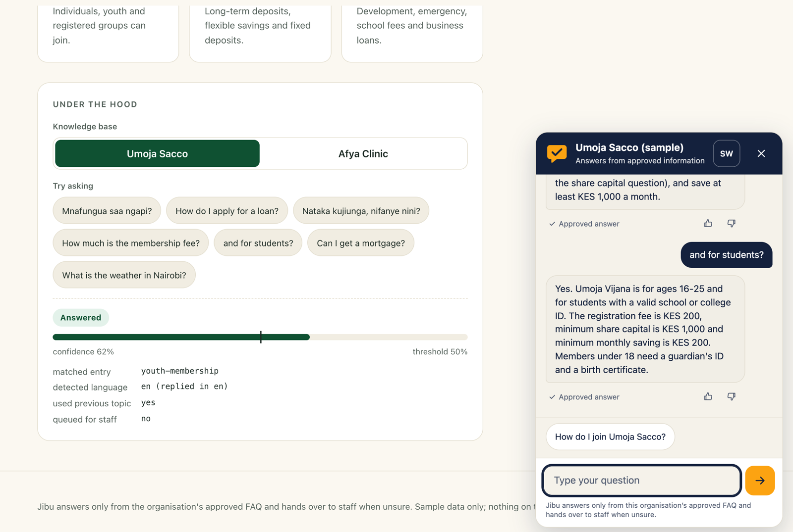
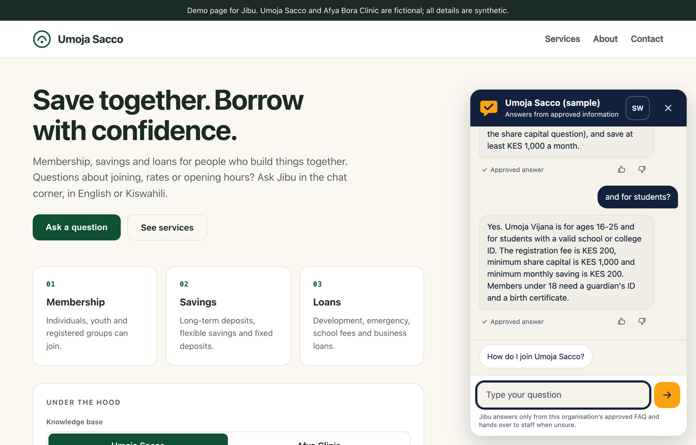
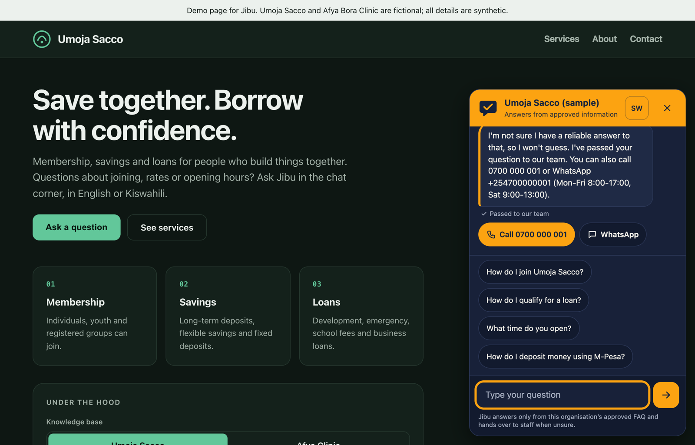
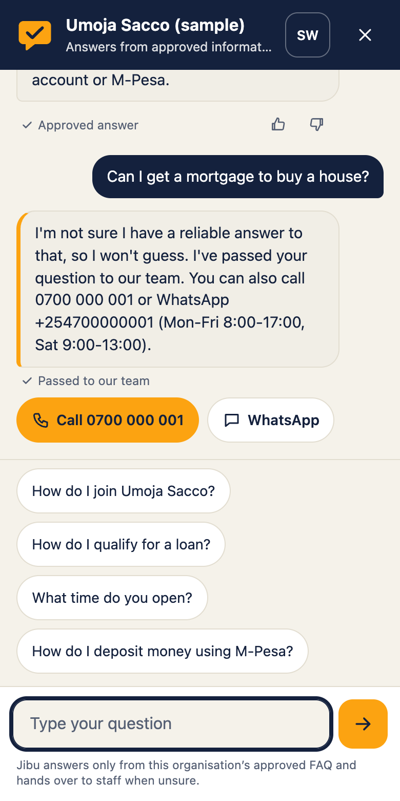
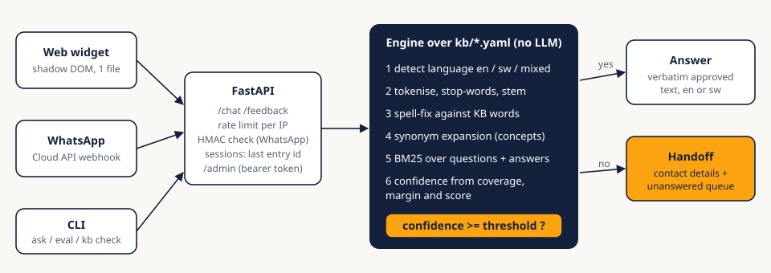
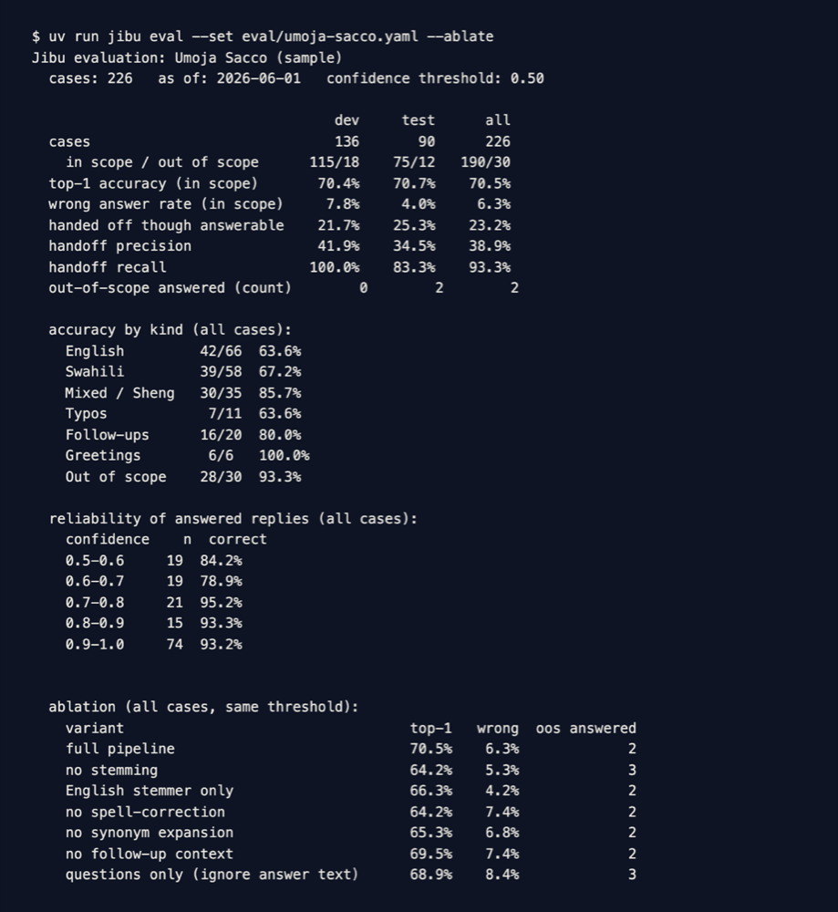

# Jibu

**Answers common questions in English and Kiswahili, only from your own approved FAQ. When it is not sure, it hands the question to a person.**

[](https://github.com/Victor-Wambua/jibu/actions/workflows/ci.yml)
[](LICENSE)


*"Jibu" is Kiswahili for "answer".*

> **Status:** portfolio build. Runs locally with synthetic sample data (a fictional SACCO and a fictional clinic). Not deployed, no real users. The WhatsApp adapter has not been tested against the live Meta API.



## The problem

A SACCO, a clinic or a small shop gets the same 40 questions on WhatsApp all day. "Mnafungua saa ngapi?" "How do I apply for a loan?" "Paybill ni ngapi?" Staff type the same replies again and again, and customers wait. A general-purpose chatbot is the wrong fix: it can invent a loan rate or a fee, and for a money business one wrong confident answer costs more than a slow reply.

Jibu takes the other route. The organisation writes its answers once, in a YAML file. Jibu finds the closest approved answer, or says "I'll pass this to our team".

## What it does

- **Answers only from `kb/*.yaml`.** No text is generated. Every reply is an approved answer, a canned greeting, or the organisation's handoff message. A test checks this.
- **English, Kiswahili and mixed.** Detects `en` / `sw` / mixed ("Nataka kujua how to apply for a loan") and replies in the customer's language. Light Sheng works through a synonym map in the KB ("doh", "mulla" mean money).
- **Hands off by default.** Below the confidence threshold the customer gets staff contact details and the question goes to an "unanswered" queue.
- **Follow-ups.** "How much is the membership fee?" then "and for students?" works. The session remembers only the last matched entry id, not the messages.
- **Validity windows.** An entry can carry `valid_from` / `valid_until`, so an expired promotion or AGM date stops being served.
- **REST API** (`/chat`, `/health`, `/admin/unanswered`, `/admin/feedback`), per-IP rate limiting, admin bearer token.
- **Embeddable widget:** one vanilla JS file, Shadow DOM, no dependencies, keyboard accessible, dark mode, full-screen on phones.
- **WhatsApp Cloud API webhook:** signature check, idempotent on message id, injectable sender. *Unverified against live Meta.*
- **CLI:** `jibu kb check`, `ask`, `eval`, `unanswered`, `serve`.
- **Evaluation harness** with 226 labelled questions for the sample SACCO. Real numbers are below, including what still fails.

| Answer | Handoff to staff | Mobile |
|---|---|---|
|  |  |  |

## Quick start

Needs [uv](https://docs.astral.sh/uv/) (it installs Python 3.12 for you).

```bash
git clone https://github.com/Victor-Wambua/jibu.git && cd jibu
uv sync

uv run jibu kb check kb                                    # validate the sample knowledge bases
uv run jibu ask "Mnafungua saa ngapi?" --org umoja-sacco   # one question
uv run jibu ask --org umoja-sacco                          # interactive chat (empty line quits)
uv run jibu eval                                           # run the labelled sets, print the report

JIBU_DEFAULT_KB=umoja-sacco uv run jibu serve --port 4110  # then open http://localhost:4110
```

The page at `/` is a fictional SACCO website with the widget and an "under the hood" panel. The API docs are at `/docs`.

```bash
curl -s localhost:4110/chat -H 'content-type: application/json' \
  -d '{"message":"How do I apply for a loan?","kb":"umoja-sacco"}'
```

Embed the widget in any page:

```html
<script src="https://YOUR-HOST/widget.js" data-kb="umoja-sacco" defer></script>
```

Set `JIBU_CORS_ORIGINS` to the site's origin when the widget and API are on different hosts. Options: `data-lang`, `data-theme`, `data-position`, `data-primary`, `data-accent`.

### Try the WhatsApp webhook locally (replies are logged, never sent)

```bash
export JIBU_WA_APP_SECRET=local-secret JIBU_WA_VERIFY_TOKEN=local-verify JIBU_DEFAULT_KB=umoja-sacco
uv run jibu serve --port 4110 &
BODY='{"object":"whatsapp_business_account","entry":[{"changes":[{"value":{"messages":[{"from":"254700000001","id":"wamid.demo1","type":"text","text":{"body":"Mnafungua saa ngapi?"}}]}}]}]}'
SIG=$(printf '%s' "$BODY" | openssl dgst -sha256 -hmac "$JIBU_WA_APP_SECRET" | sed 's/^.* //')
curl -s localhost:4110/webhooks/whatsapp -H "X-Hub-Signature-256: sha256=$SIG" -d "$BODY"   # processed
curl -s localhost:4110/webhooks/whatsapp -H "X-Hub-Signature-256: sha256=$SIG" -d "$BODY"   # duplicate, not answered twice
```

## How it works



1. **Language:** function-word and morphology heuristic, plus per-KB hints. Result is `en`, `sw`, `mixed` or `und`.
2. **Tokenise and stem:** stop-words for both languages, an English suffix stripper, and a *heuristic* Swahili stemmer (verb prefixes such as `ni-na-`, the `ku-` infinitive, `-je`, passive/applicative endings, a few noun-class prefixes, a small irregular table). It is not a morphological analyser.
3. **Spell-fix:** unknown words are matched to the KB's own vocabulary by edit distance (words of 5+ letters only).
4. **Synonyms:** groups in the KB. A typed word and its synonyms count as one "concept", so a big group cannot outvote a rare word.
5. **BM25**, written from scratch, over each entry's questions and tags, plus the answer text at lower weight. A small bonus rewards overlap with one example question.
6. **Confidence** = coverage (share of the question's rarest words that the entry explains) scaled by the lead over the runner-up. Below the threshold: handoff.

Design decisions and trade-offs are in [docs/CASE-STUDY.md](docs/CASE-STUDY.md).

## Knowledge base format

```yaml
- id: loan-guarantors
  tags: [loans, guarantors, wadhamini]
  questions:
    en: ["Do I need guarantors for a loan?", "How many guarantors are required?"]
    sw: ["Je, ninahitaji wadhamini kupata mkopo?", "Wadhamini wanaohitajika ni wangapi?"]
  answer:
    en: "Loans up to your own deposits need no guarantor. Above that you need 2 guarantors..."
    sw: "Mikopo hadi kiasi cha amana zako hauhitaji mdhamini. Juu ya hapo..."
  follow_ups: [loan-limit]          # optional
  valid_from: 2026-01-01            # optional
  valid_until: 2027-06-30           # optional
```

`jibu kb check` rejects unknown keys (a typo like `anwser:` is an error with a line number), duplicate ids, dangling follow-ups, bad dates and unknown handoff placeholders. It warns about questions in different entries that reduce to the same keywords, because the retriever can never tell those apart.

## Evaluation

`jibu eval` runs `eval/umoja-sacco.yaml` (226 cases: English, Swahili, mixed/Sheng, typos, follow-ups, greetings, and 30 out-of-scope questions) and `eval/afya-clinic.yaml` (32 cases). Numbers below are from my last run at the shipped threshold of 0.50.

| Umoja Sacco (sample) | dev (136) | test (90) | all (226) |
|---|---:|---:|---:|
| Top-1 accuracy, answerable questions | 70.4% | 70.7% | **70.5%** |
| Confidently wrong answers (answerable) | 7.8% | 4.0% | 6.3% |
| Answerable but handed off | 21.7% | 25.3% | 23.2% |
| Handoff precision | 41.9% | 34.5% | 38.9% |
| Handoff recall (out-of-scope handed off) | 100% | 83.3% | **93.3%** |

Afya Bora Clinic (sample, tiny, written after the engine was frozen): top-1 90.9%, 0 wrong answers, all 8 out-of-scope handed off.

By kind (Umoja, all): English 63.6%, Swahili 67.2%, mixed 85.7%, typos 63.6%, follow-ups 80.0%, greetings 100%.

**How the threshold was chosen.** I swept it on the dev split only and took the lowest value at which no out-of-scope question was answered (0.50). Below that, accuracy rises but the bot starts answering questions the KB does not cover; the full sweep is printed by `jibu eval --sweep`. The test split (40%) was not used for tuning; I only read its failures after the last change, to write this section.

**Ablation** (`jibu eval --ablate`, all cases): dropping the Swahili stemming rules costs 4 points (66.3% with the English stemmer only), dropping all stemming 6 points (64.2%), spell-correction 6 points (64.2%) and synonym groups 5 points (65.3%). Follow-up context is worth 1 point on this set (69.5% without it).



**What still fails** (full list: `jibu eval`):

- *Vocabulary gaps.* "How many days until the loan hits my account?" shares one word with the right entry, so it is handed off. Lexical retrieval cannot bridge this without a synonym or another example question. This is most of the 23% handed off.
- *Sibling entries.* "Je, kuna mkopo wa dharura?" (is there an emergency loan?) is answered with the loan-processing-time entry at confidence 1.00 instead of the loan-types entry.
- *Two out-of-scope questions were answered* (both in the test split): "How do I reset my Safaricom PIN?" matched the SACCO's own PIN reset, and "When is the AGM?" (the AGM entry has expired) was answered from the dividends entry, which mentions the AGM. The second is arguably a labelling call, but I left the label as written.
- *Context carry-over is a bag-of-words boost.* "and how do I take it out?" after a deposit question picks the wrong entry.
- *Caveats on the numbers.* The knowledge base, the eval questions and the tuning were done by one person on synthetic data, so the figures are optimistic compared with real WhatsApp traffic. The dev/test split guards against over-tuning to individual questions, not against the author's own phrasing habits. Some synonym groups, stemmer rules and the confidence weights were adjusted after looking at dev failures.

Speed: about 0.7 ms per question and 60 ms to build the index on my laptop (39 entries, measured, not a benchmark claim for larger KBs).

## Testing

```bash
uv run pytest                 # 184 tests, offline, ~6 s; 94% line coverage
uv run ruff check . && uv run ruff format --check .
uv run mypy                   # strict
make check                    # all of the above
```

Covered: tokenizer and both stemmers; BM25 properties (idf, saturation, length normalisation, hand-computed score, random corpora); language detection; KB validation (every error class, with line numbers); engine behaviour (answers, handoff, typos, validity windows, follow-ups, determinism, verbatim-answer guarantee); API flows, input validation, admin auth, rate limiting (including a spoofed `X-Forwarded-For`), CORS, security headers; WhatsApp signature valid / tampered / missing / wrong secret, handshake, replayed message id, mixed batches, malformed payloads, number masking in logs; redaction and the opt-in unanswered queue; and an **evaluation floor** (`tests/test_eval_regression.py`) that fails CI if top-1 accuracy drops below 65%, out-of-scope recall below 90% or wrong answers above 9%. No test touches the network. The one HTTP-sender test uses an in-memory mock transport to check the request shape; it does not call Meta.

## Project layout

```
kb/                 umoja-sacco.yaml (39 entries), afya-clinic.yaml (11)  - synthetic
eval/               labelled question sets
src/jibu/
  text.py lang.py bm25.py     tokenizer, stemmers, language detection, BM25
  kb.py                       schema and validation
  engine.py                   retrieval, confidence, handoff, context
  evaluation.py evalreport.py harness and reports
  api.py service.py           FastAPI app and shared glue
  whatsapp.py                 webhook adapter (signature, idempotency, senders)
  privacy.py unanswered.py    redaction, opt-in queue
  ratelimit.py sessions.py config.py cli.py
  web/                        jibu-widget.js, demo.html, demo.js
tests/              184 tests
docs/               CASE-STUDY.md, architecture.svg, screenshots/
```

## Configuration

All through environment variables; see [`.env.example`](.env.example).

| Variable | Default | Meaning |
|---|---|---|
| `JIBU_KB_DIR` | `kb` | directory of knowledge base files |
| `JIBU_DEFAULT_KB` | first by name | KB used when a request names none |
| `JIBU_THRESHOLD` | KB file value (0.5) | confidence threshold override |
| `JIBU_RATE_LIMIT` | `30/60` | requests per seconds, per IP |
| `JIBU_ADMIN_TOKEN` | unset | enables `/admin/*`; unset means disabled |
| `JIBU_STORE_UNANSWERED_TEXT` | `false` | keep redacted text of handed-off questions |
| `JIBU_UNANSWERED_FILE` | unset | JSONL file for the unanswered queue |
| `JIBU_WA_APP_SECRET`, `JIBU_WA_VERIFY_TOKEN` | unset | WhatsApp webhook (disabled without the secret) |
| `JIBU_WA_SEND` | `false` | `true` calls the Cloud API; default only logs |

## Privacy

By default Jibu stores **no message text**. Sessions hold the last entry id and language. The unanswered queue keeps only time, language, confidence and closest entry. Setting `JIBU_STORE_UNANSWERED_TEXT=true` stores the text after masking phone numbers, e-mails, links, M-Pesa codes and long digit runs. This is pattern-based: names and free-text details are **not** detected. WhatsApp senders are reduced to an HMAC pseudonym and logged with only the last three digits.

## Status and roadmap

Working and tested locally: everything listed above. Not done, or not verified:

- **WhatsApp against live Meta:** written from the public webhook docs; never run against a real account.
- **Single process:** rate limits, sessions and the seen-message cache are in memory. Several workers need a shared store.
- **No admin UI** for the unanswered queue; staff use the CLI or API.
- **Heuristic NLP:** the Swahili stemmer and language detector are rules of thumb. Sheng is only what the synonym map lists.

Next steps: an admin page that turns an unanswered question into a new KB entry in one click; clarifying questions when two entries tie; an optional local embedding re-ranker, measured against this same harness before it is allowed in; evaluation on real (consented, redacted) traffic from a pilot organisation.

---

Built by Victor Wambua · [portfolio](https://victor-wambua.github.io/victor-portfolio/) · [case studies](https://github.com/Victor-Wambua/case-studies)

Licensed under the [MIT License](LICENSE). All organisations, numbers and contacts in `kb/` are fictional.
