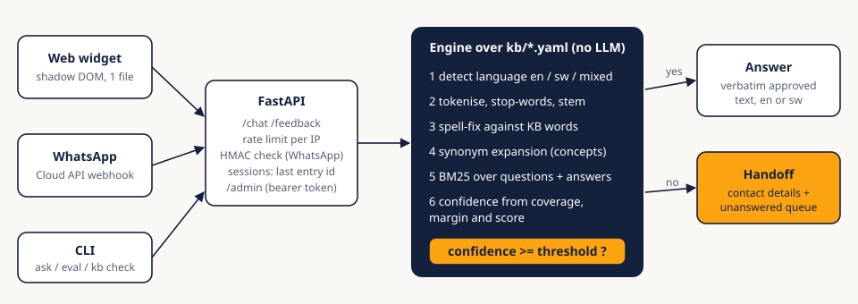
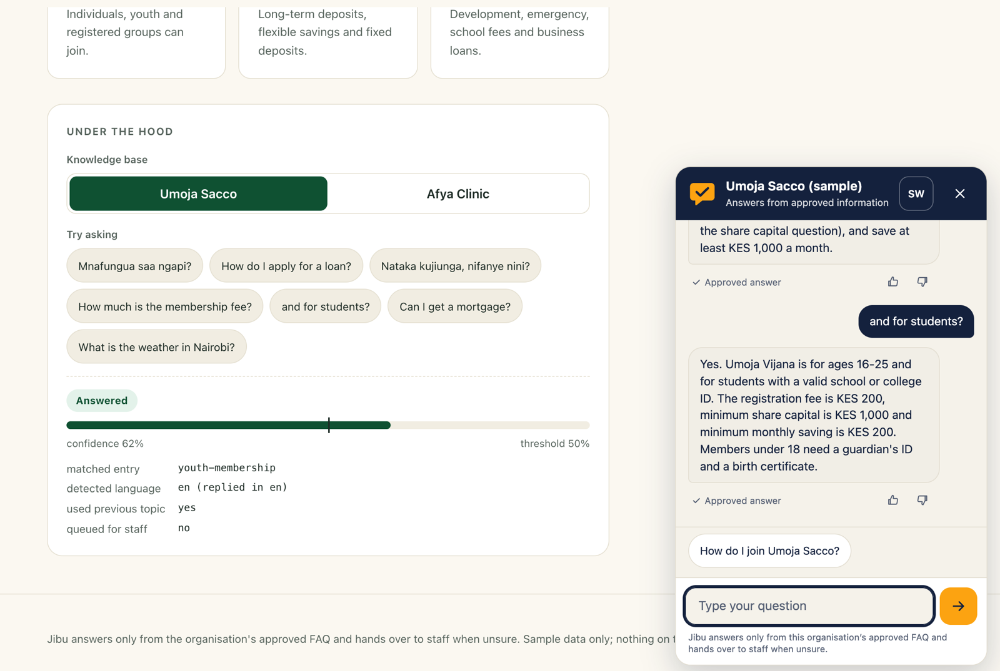

# Jibu: a FAQ bot that would rather say "I don't know"

## The problem

Small organisations in Kenya run on WhatsApp. A SACCO, a clinic, a school office or a shop gets the same few dozen questions every day: opening hours, how to join, which paybill, what the loan rate is, who can guarantee. One or two staff answer them by hand, copying from an old message or from memory. Customers wait, and the answers drift. Two people quote two different fees.

The obvious fix today is to plug in a large language model. For this kind of business I think that is the wrong tool. In a money business the cost of a wrong confident answer ("the processing fee is 0.5%") is much higher than the cost of a slow one. I work on the systems behind the money, and the first rule there is that a number is either right or it is flagged. I wanted a chatbot that follows the same rule.

## Goals and non-goals

**Goals**

- Answer only from text the organisation has written and approved.
- Work in English, Kiswahili and the mixed form people actually type.
- Say "I will pass this to our team" whenever it is unsure, and keep a list of what it could not answer.
- Run on a cheap server with no outside API: no per-message cost, no data leaving the building.
- Be measured. Report real accuracy, including what fails.

**Non-goals**

- Open conversation, advice, or anything generative.
- Learning from customers' messages. The knowledge base changes only when a human edits it.
- Replacing staff. The product is the queue of questions staff no longer have to type answers to.

## What I built

Jibu is a Python 3.12 / FastAPI service with a retrieval engine I wrote myself (no search library, no ML dependency): a tokenizer with English and Swahili stop-words, a heuristic stemmer, spell-correction against the knowledge base's own vocabulary, synonym groups, BM25, and a confidence score with a threshold. Around it sit a REST API, a one-file embeddable chat widget, a WhatsApp Cloud API webhook adapter, an admin CLI and an evaluation harness.

The knowledge base is a YAML file per organisation: questions and answers in both languages, tags, optional follow-up suggestions and optional `valid_from` / `valid_until`. I wrote a synthetic SACCO (39 entries) and a small clinic (11). `jibu kb check` validates a file on load and reports mistakes with line numbers.

## Design decisions and trade-offs

**1. Retrieval, not generation.** A generative model can paraphrase, which is the problem: it can also invent. With retrieval the output space is a closed set of sentences someone approved, and I can test that property directly (a test asserts every reply is verbatim KB text, a greeting or the handoff message). The price is recall. A paraphrase that shares no words with any stored question is missed. I accepted that because a miss costs a person typing one reply, and a wrong answer can cost a customer money. The alternative I considered was retrieval plus a model that rewrites the answer. It adds a dependency, a cost per message and a way to change a number in transit, and it needs its own evaluation. I left it out.

**2. Handoff is the default, not the error path.** Every reply passes one gate: confidence at or above a threshold, else handoff. The handoff message includes the contact details and the question goes into a queue for staff. I treat the queue as the product's feedback loop: each handed-off question is either a missing entry, a missing synonym, or something genuinely out of scope.

**3. A confidence score built from coverage, not raw BM25.** BM25 scores are not comparable between questions, so a threshold on them means nothing. I compute *coverage*: the share of the question's words, weighted by how rare they are, that the best entry explains. Words that appear nowhere in the knowledge base count heavily against it, which is what separates "what is the weather in Nairobi" (one word matches "Nairobi" in a branch address) from a paraphrase. Coverage is then scaled by the lead over the runner-up, so ambiguous questions score low. This took several rounds. My first version used synonym expansion as plain extra query terms, and a 17-word "member / join / register" group drowned out the one rare word the customer typed ("dividend"). Scoring each synonym group as a single concept, best match wins, fixed that.

**4. Swahili morphology, handled honestly.** Swahili packs subject, tense, object and extensions into one verb: *nitalipa*, *unalipa*, *wanalipa*, *kulipia*, *kulipwa*, *nalipaje* all point at *lipa*. Nouns change class prefix between singular and plural: *mkopo* / *mikopo* (loan), *tawi* / *matawi* (branch). A stemmer needs rules for these, and rules over-reach: stripping `ma-` from *management* is nonsense. My answer was (a) a small rule-based stemmer, explicitly not a morphological analyser, (b) a guard that stems any word seen in the KB's English text as English only, (c) a short hand-written table for irregular pairs like *wanachama / mwanachama*, and (d) measuring it. In the ablation the Swahili rules are worth about 4 points of top-1 accuracy. I did not try to build a full analyser; for a FAQ the stemmer only has to map the words in the KB and in customers' messages to the same key, whatever the key is. Sheng and code-switching are handled the same plain way: the language detector has a "mixed" result and replies in the dominant language, and slang such as *doh* or *mulla* lives in the organisation's synonym list. A tokenizer cannot know that *doh* means money; the person who runs the SACCO does.

**5. How the threshold was chosen.** I did not pick 0.5 and hope. I split the labelled questions 60/40 into dev and test by a fixed rule, swept the threshold on dev, and took the lowest value at which no out-of-scope question was answered. Lower thresholds answer more correctly but also start answering things the KB does not cover (at 0.35 on dev, 3 of 18 out-of-scope questions were answered). I also print a reliability table: answers at confidence 0.5 to 0.6 were right 84% of the time, and above 0.7 around 93% to 95%. The score is ordered, not perfectly calibrated. The sample KB's threshold lives in the KB file, because the right value depends on how many entries and how many phrasings it has.

**6. Privacy by omission.** The simplest way not to leak message content is not to keep it. Sessions store the id of the last matched entry and the language, nothing else. The unanswered queue stores time, language, confidence and closest entry by default. If an organisation opts in to keeping the text, it is passed through a redactor first (phone numbers, e-mails, links, M-Pesa codes, long digit runs). The redactor is pattern-based and I say so: it will not find a name or an address typed in free text. WhatsApp numbers become an HMAC pseudonym and appear in logs with three digits.

## How it is kept correct and safe

- **Tests.** 184 offline tests, 94% line coverage, mypy strict, ruff. They cover the tokenizer and stemmers, BM25 properties (idf ordering, term-frequency saturation, length normalisation, a hand-computed score, random corpora), KB validation errors, engine behaviour, API flows and rate limiting.
- **An evaluation floor in CI.** `tests/test_eval_regression.py` runs the labelled sets and fails the build if top-1 accuracy, out-of-scope recall or the wrong-answer rate cross a recorded floor. Raising a floor is allowed; lowering one to pass a change is not.
- **Evaluation hygiene.** A test checks that no eval question is a copy of a KB example question. I learned why this matters on this project: while tuning I added example questions to the KB after seeing dev failures, and a quick check showed 52 of them were near-copies of eval questions. I removed them. The KB-lint also caught two entries whose example questions differed only by stop-words ("Who can join?" vs "How do I join?") and so could never be told apart.
- **WhatsApp webhook.** The signature is checked over the raw bytes with a constant-time compare before the body is parsed. Message ids are remembered so Meta's retries are not answered twice; a replayed request is acknowledged and ignored. Replies go through an injectable sender; the default only logs.
- **API.** Input is validated (length, session id pattern, unknown fields rejected), admin endpoints need a bearer token and are off if none is configured, rate limiting is per IP and does not trust `X-Forwarded-For` unless told to, and the widget builds the DOM with text nodes only.
- **Failure modes.** An invalid KB file stops the server at start with every error listed. A send failure on WhatsApp is logged and does not make Meta retry the batch. Expired entries are skipped at query time.

## What the numbers say

On the 226-question sample set at the shipped threshold: 70.5% top-1 on answerable questions (70.4% dev, 70.7% test), 6.3% answered with the wrong entry, 23.2% answerable but handed off, and 28 of 30 out-of-scope questions handed off (the two misses are in the README). On the small clinic set: 90.9% and none wrong. These come from a knowledge base, a question set and a tuning process that I wrote and ran myself on synthetic data. Real traffic will be messier, so treat them as an upper bound.

## What I would do differently, and what is next

- **Write the eval set before the KB**, ideally with someone who does not know the KB. The leakage problem above is the biggest weakness in the numbers.
- **Keep the question words.** Stop-word removal erases "who", "how" and "when", which are exactly what separate an eligibility entry from a how-to entry. I worked around it with a lint rule and a small bonus for overlap with a single example question. A better design keeps them as light features.
- **Context carry-over is crude.** It boosts the previous topic's words. It helped on 16 of 20 follow-ups but is worth only one point overall, and it still picks wrong entries for vague follow-ups.
- **Next:** an admin page that turns an unanswered question into a KB entry, clarifying questions when two entries tie, a local embedding re-ranker that must beat this harness before it ships, and a pilot with consented, redacted traffic from a real organisation.

## Status

Portfolio build. It runs locally on synthetic data for a fictional SACCO and clinic. It has no users and is not deployed. The WhatsApp adapter is written from Meta's public documentation and has never talked to the live API; the real HTTP sender is never called in tests. Rate limits, sessions and the seen-message cache are in memory, so it is a single-process service. Repository: <https://github.com/Victor-Wambua/jibu>.
